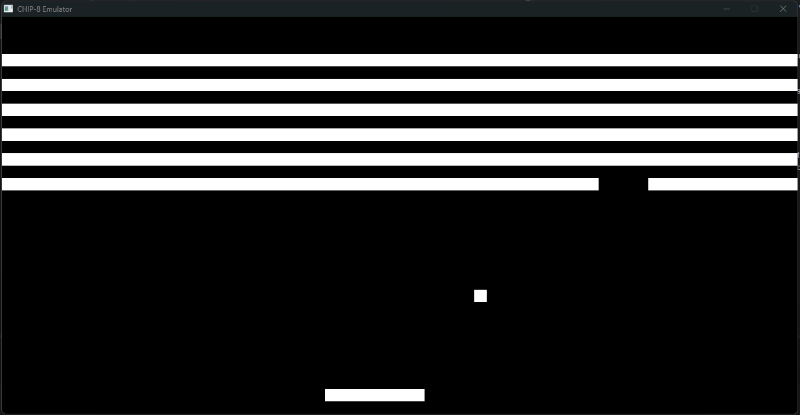
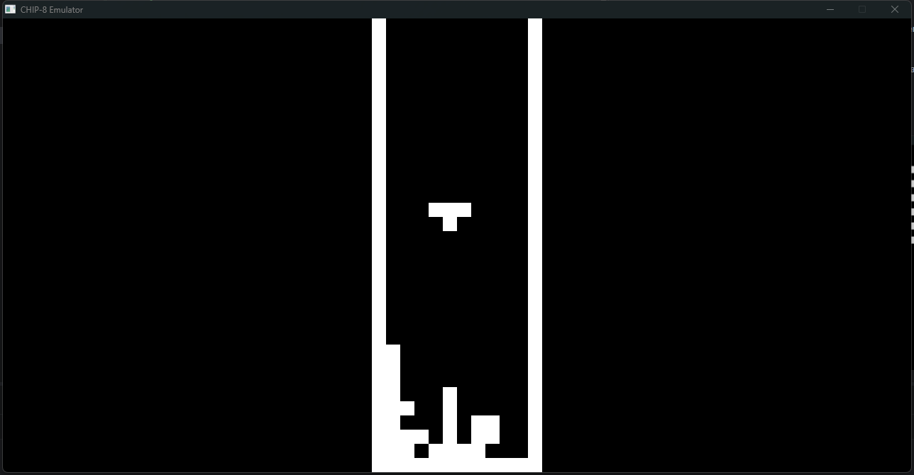

# CHIP-8 Emulator

## About

This personal project aims to build a working CHIP-8 emulator in C++ without the use of any LLM tools or AI advice.
The goal for me, by the end of this project, is to:
- Learn the basics of C++
- Understand the core concepts of operating systems and computer architectures
- Develop an interest in programming with lower-level languages

This project is licensed under the MIT license, so you're free to do whatever with it.

## Screenshots

## Background
I wanted to get into low-level programming because it seemed interesting. What better way to start than attempting to
write a CHIP-8 emulator without any experience writing code in C++?

## Tasklist
- [x] CPU implemented
- [x] Input implemented
- [x] Display implemented
- [x] Sound implemented

## Future Scope
Adjustable speed / tick rate, better UI.

Potentially a CHIP-8 assembler packaged with this. I could also move on to a more complex system 
to emulate like the NES.

## References used
- https://www.freecodecamp.org/news/creating-your-very-own-chip-8-emulator/
- http://devernay.free.fr/hacks/chip8/C8TECH10.HTM
- https://github.com/libsdl-org/SDL/blob/main/examples/audio/01-simple-playback/simple-playback.c
- https://tobiasvl.github.io/blog/write-a-chip-8-emulator

Special thanks to [Technohacker](https://github.com/Technohacker) for guiding me through this project!